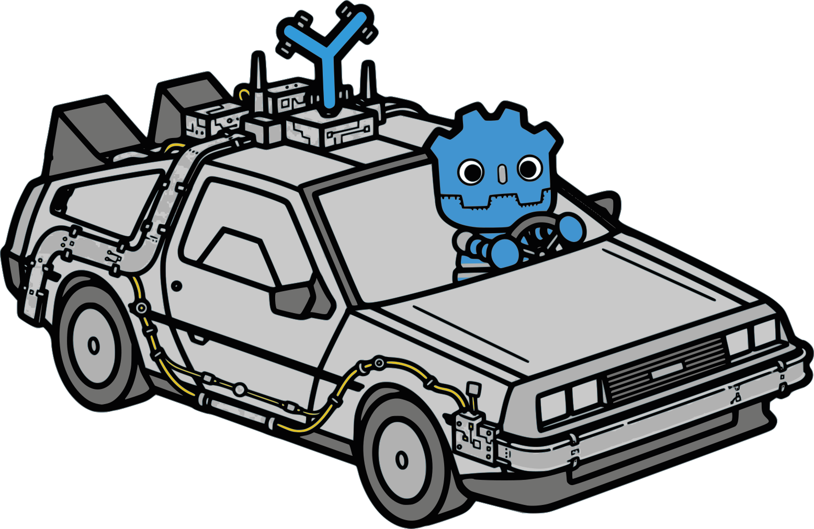

# GdTimeMachine

<p align="center">
  
</p>

**Record any scene, rewind any commit.**

GdTimeMachine records your scenes right from the editor — no external capture or window setup. Pick a backend, hit Record, and get a clip named for the scene and time. Built for the “time machine” workflow: rewind your project to any git commit and capture it again to diff how a scene looked across history.

## Installation

### Asset Library

GdTimeMachine is listed on the Godot Asset Library: https://godotengine.org/asset-library/asset/5430

1. In Godot: **AssetLib → Search "GdTimeMachine" → Download → Install**
1. Then **Project > Project Settings > Plugins → Enable GdTimeMachine**

### Manual Install

```sh
# from your project root
cp -r /path/to/GdTimeMachine/addons/GdTimeMachine addons/
```

Then in Godot:

1. Open **Project > Project Settings > Plugins**
1. Enable **GdTimeMachine**

No extra dependencies for the built-in backends. OBS and ffmpeg are optional (see below).

## Quick Start

1. Open the **GdTimeMachine** dock in the **bottom panel**.
1. Pick a **backend**, **format**, and **FPS** (duration `0` = record until stopped).
1. Press **Record** — press **Stop** when done. Files are named `<scene>_<timestamp>.<ext>` in your output dir.

Shortcuts:

- `Ctrl+Alt+R` / `Cmd+Alt+R` (macOS) toggles recording from anywhere in the editor.
- **Command Palette** → `GdTimeMachine: Toggle Recording`.
- Rebind via `Project > Editor Settings > Shortcuts` → `gd_time_machine/toggle_recording`.

The dock status line shows live state while recording (backend, output file, elapsed time) and the final save/convert result.

> **Tip:** Check *Remember settings for this scene* in the dock to save per-scene overrides.

## Backends

- **Movie Maker** (`RESTART_SCENE`) — AVI / OGV / PNG. Restarts the scene to record. AVI capped at **4 GB** (auto-stops before cap). No external deps.
- **Screenshot** (`IN_PLACE`) — PNG / JPG native (+ ffmpeg → MP4 / WebM / AVI / OGV). Records the running scene in real time (~15 fps, no audio). Window must stay visible. No restart, no kill on Stop.
- **OBS Studio** (`IN_PLACE`) — MP4 native (Full FPS + audio, auto-launches via WebSocket if not running, no scene restart) + ffmpeg → WebM / AVI / OGV post-convert after stop.

`RESTART_SCENE` backends must relaunch the scene, so the in-game record button is disabled while a scene runs. `IN_PLACE` backends capture the running scene directly; if nothing is running, Record launches the scene first.

OBS always appears in the backend list under its plain name — installed-but-idle stays selectable (it auto-launches on Record, with a "will auto-launch" tooltip). If truly unavailable (not installed) the entry is greyed and unselectable with the install reason as tooltip; ffmpeg-dependent formats use the same disabled + tooltip treatment when ffmpeg is missing. Launch progress is narrated in both the dock status line and the terminal `[GdTM]` log.

## OBS Setup

Linux and Windows only — on other platforms the backend stays unselectable with the reason shown.

1. **Install OBS Studio** (obsproject.com).
1. In OBS: **Tools → WebSocket Server Settings → Enable WebSocket Server** (default port `4455`). Set a password if desired.
1. In Godot: **Project > Editor Settings → `gd_time_machine/obs/*`** — set matching `host`, `port`, and `password`.
1. Optional `obs/*` settings: `scene` (record target, default `GdTimeMachine`), `auto_launch` (default on), `auto_close` (stop OBS we launched when Godot closes), `auto_setup_scene` (default on — build the PipeWire capture scene when the record scene is empty), `binary_path` (custom OBS binary).

Each Record targets your game window directly — no picker: on Linux the game reports its X11 window id over the debugger channel and OBS captures it via `xcomposite_input` (OBS is auto-launched under XWayland so the kind registers); on Windows OBS captures `[exe]: title` via `window_capture` (best-effort — exact-title matching is OBS-side). Whatever can't be targeted programmatically falls back exactly once to PipeWire screen capture (which needs one human share pick, remembered afterwards); if that fails too, the recording errors instead of going black. Progress is narrated in both the dock status line and the terminal `[GdTM]` log.

The gear button next to the backend dropdown re-opens the capture status dialog anytime: which scene/source/target the next Record will use, plus a one-shot **Set up window capture now** action. **If PipeWire-fallback recordings show the wrong window**: its saved share points at the wrong target — delete that share in OBS (or the whole `GdTimeMachine` scene and let the next Record rebuild it) and re-pick the game window.

## Output Formats

The format dropdown is backend-aware — it shows native formats plus what ffmpeg can convert to.

- **Native (no ffmpeg):** AVI, OGV, PNG sequence, JPG sequence (availability depends on backend).
- **Converted via a transcoder (ffmpeg):** MP4 (H.264), WebM (VP9), AVI, OGV from a backend's native artifact — e.g. Movie Maker AVI → MP4, Screenshot PNG/JPG frames → MP4/WebM, OBS MP4 → WebM.

Tier-2 conversion is **on by default** (`transcoders/ffmpeg/auto_convert`). It uses the capture's measured average FPS. If no transcoder is available or conversion fails, the native artifact is kept and the status line explains why — never a lost recording. On success, intermediate frames/files are cleaned up per `clean_frames`.

- AVI: MJPEG, largest files, 4 GB cap.
- OGV: Theora+Vorbis, editor binaries only.
- PNG/JPG: image sequences, lossless/compact masters.
- MP4/WebM: require ffmpeg.

### ffmpeg Setup (for MP4 / WebM)

Godot has no built-in MP4 writer — MP4/WebM come from ffmpeg tier-2 conversion of the native artifact.

1. **Install ffmpeg:** Linux `sudo apt install ffmpeg`, macOS `brew install ffmpeg`, Windows `winget install ffmpeg` / `choco install ffmpeg`.
1. **Verify on PATH:** `ffmpeg -version` should print a version; `which ffmpeg` shows the path.
1. **Tell Godot where it is:** if on `PATH`, nothing to do; otherwise set **Project > Editor Settings → `transcoders/ffmpeg/path`** to the full path. Test with an MP4/WebM recording — status shows `Converted` or a missing-tool notice.

Disable tier-2 via `transcoders/ffmpeg/auto_convert = false` to keep native formats only.

## Configuration

All defaults live in **Project > Editor Settings** and can be overridden per scene.

**Recorder (`gd_time_machine/recorder/*`):**

- `output_dir` — where recordings are written (default `res://media/captures`)
- `output_format` — default format (`avi`, `ogv`, `png`, `jpg`, `mp4`, `webm`)
- `default_backend` — backend selected by default
- `default_fps` — target FPS cap
- `default_duration` — seconds (`0` = until stopped)
- `default_resolution` — capture size `WIDTHxHEIGHT`, e.g. `1920x1080` (empty = the project's window size)

**Transcoders (`transcoders/*`):**

- `active` — ordered transcoder preference (default `["ffmpeg"]`)
- `transcoders/ffmpeg/*`: `path` — custom ffmpeg binary (empty = `PATH` lookup)
- `transcoders/ffmpeg/*`: `auto_convert` — auto-convert tier-2 formats after recording (default `true`)
- `transcoders/ffmpeg/*`: `clean_frames` — delete frames after successful conversion (default `true`)

**OBS (`gd_time_machine/obs/*`):**

- `host`, `port`, `password`, `scene`, `auto_launch`, `auto_close`, `auto_setup_scene`, `binary_path`

**Shortcut:**

- `gd_time_machine/toggle_recording` — `Ctrl+Alt+R` / `Cmd+Alt+R`

**Per-scene overrides** — `addons/GdTimeMachine/config/state/profiles.cfg` (gitignored by default):

```ini
[default]
output_dir = res://media/captures
output_format = mp4
fps = 60
duration = 30

["res://scenes/menu.tscn"]
fps = 30
output_format = png
resolution = 1920x1080
user_args = --shot=wide --seed=3
```

Each `["res://..."]` overrides `[default]`. Edit directly or use *Remember settings for this scene* in the dock. Commit for shared team profiles.

**Capture size** (dock *Size*, `resolution`): Movie Maker fixes its frame size from the project's window size settings when the game starts — `--resolution` alone resizes the window, not the footage. So the Movie Maker backend writes the size into `res://override.cfg` (`display/window/size/window_*_override`) for the duration of the recording and then restores the file exactly as it was (or removes it). If the editor crashes mid-recording, the file says so in its first line; delete it. Sizes larger than the screen work (e.g. `2560x1440` for a downscaled master). In-place backends record the running window as is.

**Game args** (dock *Args*, `user_args`): space-separated args for the game, e.g. `--shot=wide --seed=3`, passed after `--` so the game reads them with `OS.get_cmdline_user_args()`. The Movie Maker backend appends them to `editor/run/main_run_args` (in memory) while recording and restores it afterwards. No quoting: the editor splits run args on spaces. Stored per scene in `profiles.cfg`, not in Editor Settings.

## Game log

Each Movie Maker recording saves what the game printed beside the clip: `<label>.log` from `gdtime run`, `<scene>_<timestamp>.log` from the dock. Everything that goes through Godot's logger lands there — `print`, `printerr` (marked `(stderr)`), `push_warning`/`push_error` and engine errors — after a few `#` header lines (scene, fps, resolution, args; for `gdtime`, the commit and its resolved SHA):

```text
# gdtime capture: intro-plan
# commit: scene-visual-pass -> 3f2a9c1…
# lines: [frame N | T s] text — N is the 0-based video frame the line was printed on, T = N / fps
[frame 0 | 0.000s] smoke: user args ["--seed=3"]
[frame 124 | 2.067s] RESULT plan: gather -> build
```

Lines are stamped with the **movie frame** rather than the wall clock: Movie Maker runs fixed-step (each frame advances exactly `1/fps` of game time however long it takes to render), so `N` is the first video frame that can show the line's effect and `T` is its timestamp in the footage — overlays can sync to it exactly. Wall-clock time drifts from the footage whenever rendering is slower or faster than real time.

How: the recorder creates the log file before launching the game, and a logger in the game (`autoload/capture_log.gd`, hosted by the GdTimeMachine autoload) appends to it only when the game is writing a movie and that file exists, so plain Movie Maker runs and exported games are untouched. `gdtime run` copies the two scripts into each worktree (`.gdtime/`) and registers them through `override.cfg`, so commits that predate the addon get a log too. Needs Godot 4.5+ in the captured game (`Logger`); older engines get a one-line note instead. The game's output still appears in the terminal or the editor's Output panel as before.

Screenshot and OBS recordings have no game log: their game is not writing a movie, which is what the in-game logger keys on, and the editor sees that game's output only over the debugger connection, which the recorder does not tap.

## CLI — batch capture (history)

`gdtime` is the headless companion for the time-machine workflow — same `plugin.cfg` version as the editor plugin, no extra dependencies.

```sh
gdtime validate <manifest.json> [--strict]          # check manifest (strict rejects unknown keys)
gdtime run [options] <manifest.json>                # worktree → godot → build → record
gdtime doctor [--verbose] [--fix]                   # git / godot / ffmpeg / OBS / build hook / worktrees
gdtime list-commits <manifest.json>                 # commit label for each capture
gdtime --help
gdtime --version
```

**Manifest** (`res://addons/GdTimeMachine/cli/schema/batch_manifest.schema.json`): `project_root`, `captures[]` with `commit` (any git ref `git rev-parse` resolves: SHA, branch, tag, `HEAD`; the resolved SHA is printed), `scene` (`res://…`), `label` (`[A-Za-z0-9_-]+`, unique), optional `duration`/`fps`/`fullscreen`/`resolution`/`godot_version_hint`/`output_path`/`build_command` and top-level `godot_path`/`build_command`/`output_dir`/`resolution`/`user_args` (defaults for entries without their own).

- `resolution` — `"1920x1080"`: passed as `--resolution` and written into the worktree's `override.cfg` as the window size override, which is what sizes Movie Maker footage.
- `user_args` — `["--scene=res://a.tscn", "--seed=3"]`: appended after `--` on the game's command line (`OS.get_cmdline_user_args()`). An entry's list replaces the top-level one.
- `fullscreen` — passes `--fullscreen`. The footage keeps the project's window size (or `resolution`), not the screen's.

**`run` options:** `--dry-run` (preview), `--resume LABEL` (skip before label), `--keep-worktrees` / `--keep-failed`, `--no-git` (HEAD-only), `--force` (overwrite), `--build-timeout SECS` (default 600), `--fail-fast`, `--strict`.

**Examples:**

```sh
gdtime validate test/cli/manifest_history.json
gdtime run --dry-run test/cli/manifest_history.json
gdtime run test/cli/manifest_history.json
gdtime doctor --verbose
```

History uses `godot --path <worktree> --write-movie` (Vulkan, no `--headless`) with `godotenv`/`GODOT_BIN` resolution and `rm -rf .godot && godot --editor --headless --quit` cache regeneration. Wrapper is `addons/GdTimeMachine/cli/gdtime` (`godot --headless -s addons/GdTimeMachine/cli/main.gd -- …` also works).

Exit codes: `0` ok, `1` failure, `2` degraded/partial (doctor warnings or `run` with `--keep-failed`).

## License

Apache-2.0 — see [LICENSE.txt](LICENSE.txt).
